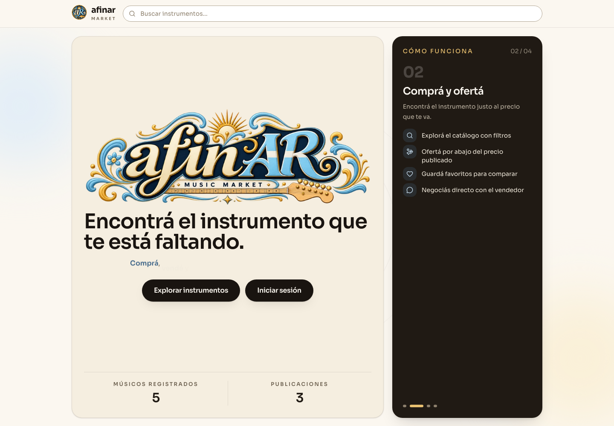
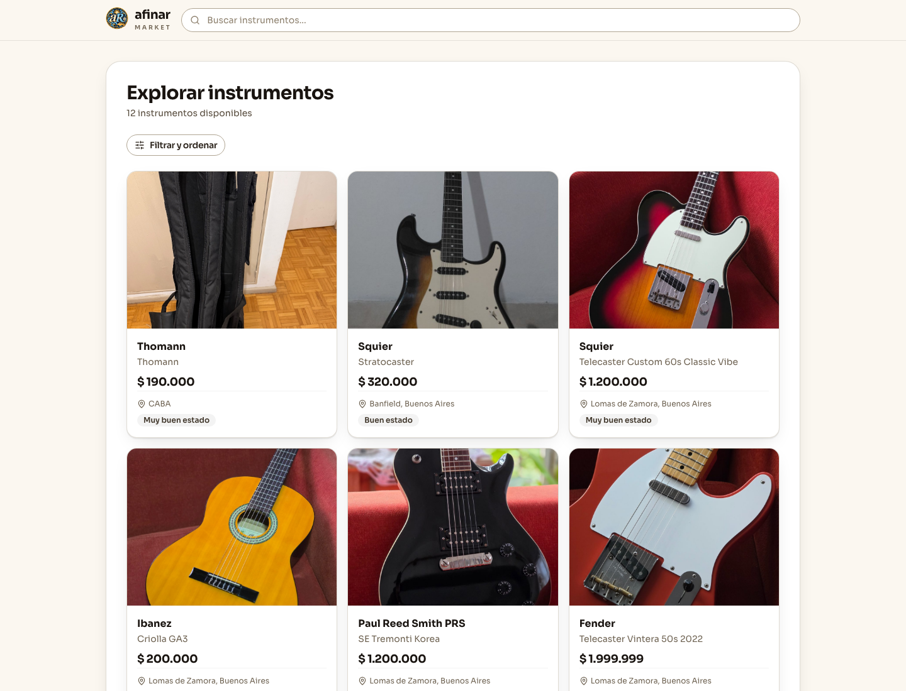
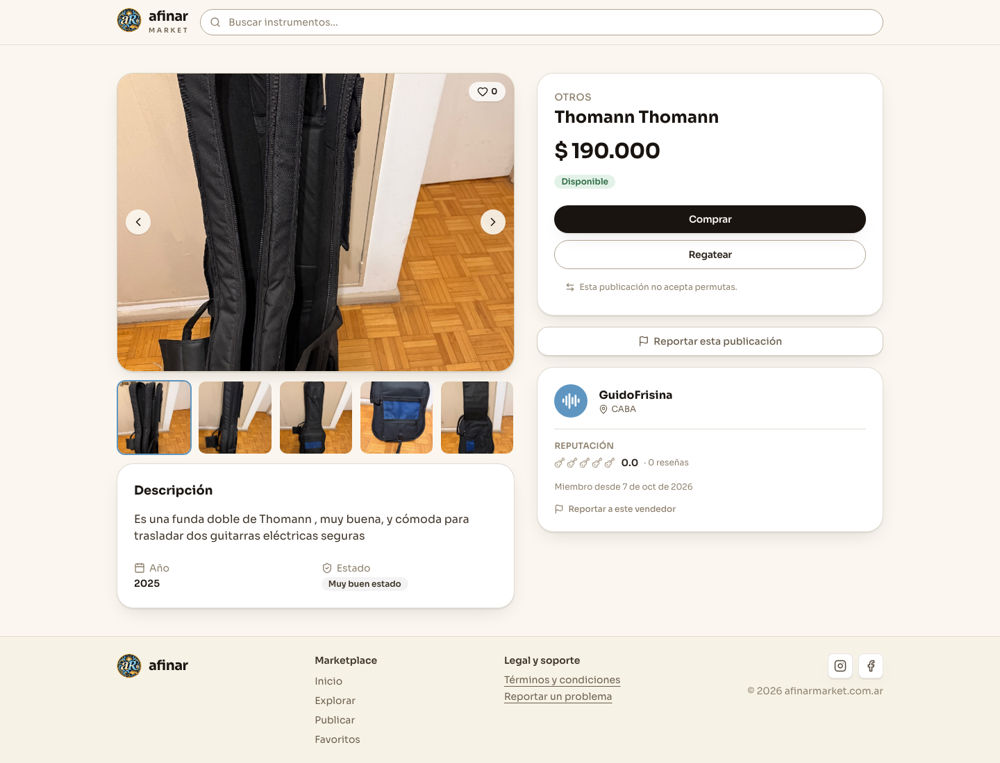
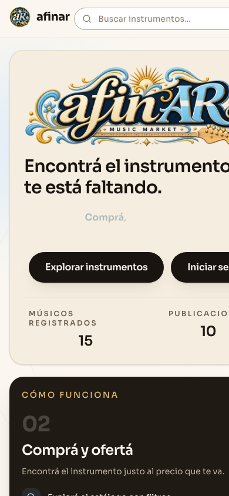

# afinarmarket.com.ar

Marketplace argentino de instrumentos musicales usados y nuevos para **comprar, ofertar y permutar** de forma segura.

🔗 **Sitio en vivo:** https://www.afinarmarket.com.ar

## Qué es

afinarmarket conecta músicos que quieren vender, comprar o permutar instrumentos. Cada publicación muestra fotos, estado, precio y ubicación; los interesados pueden ofertar (compra o permuta), contraofertar y cerrar el acuerdo. Al concretarse, se libera el contacto entre las partes y después pueden calificarse mutuamente.

## Funcionalidades

- **Catálogo público** con búsqueda por marca/modelo, filtros (categoría, condición, precio, moneda, permuta y ubicación), orden y paginación.
- **Publicación de instrumentos** con fotos optimizadas, edición, pausa/activación y estados.
- **Negociaciones**: ofertas de compra y permuta, contraofertas, aceptar, rechazar y cancelar.
- **Operaciones** concretadas con contacto liberado y **reputación** (estrellas + reseña).
- **Favoritos** y panel personal.
- **Sugerencia de descripción con IA** a partir de las fotos (opt-in).
- **Reportes y moderación** con panel de administración.
- **Cuentas seguras**: verificación por email, sesiones, recuperación de contraseña y consentimiento de términos versionado.

## Capturas

| Catálogo | Ficha de instrumento |
| --- | --- |
|  |  |

  

## Documentación técnica

Arquitectura, modelo de datos, API, seguridad y despliegue: [docs/technical-overview.md](docs/technical-overview.md).

## Pruebas y calidad

- **527 tests automatizados**: 304 de API y 223 de web.
- Pipeline de GitHub Actions en cada push: tests, ESLint, formato y build.
- Verificación post-despliegue de healthcheck, búsqueda y migraciones.

## Stack

- **Frontend:** React + TypeScript + Vite + Tailwind CSS
- **Backend:** Node.js + TypeScript + API REST + PostgreSQL
- **Infra:** Vercel (web y API), Supabase (base de datos y storage de fotos), Brevo (emails transaccionales), Gemini / Cloudflare (sugerencia de descripción con IA)

## Estado

El sitio está **en vivo** y en etapa de lanzamiento. Este repositorio es una **vitrina** del proyecto con capturas y descripción del producto; el código fuente se mantiene privado.

## Contacto

soporte@afinarmarket.com.ar
