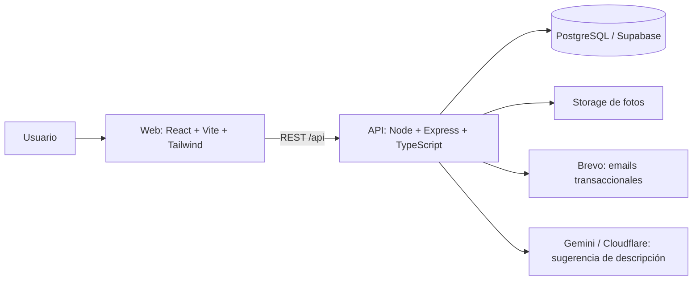

# Documentación técnica — afinarmarket

> Vitrina técnica del proyecto. El código fuente se mantiene en un repositorio privado; este documento describe la arquitectura y las prácticas de ingeniería sin exponer credenciales, infraestructura interna ni datos de usuarios.

## Arquitectura general

Aplicación web con frontend y backend separados. El frontend consume una API REST; la base de datos, el storage, el envío de emails y las integraciones de IA quedan siempre del lado del backend.

## Stack

| Capa | Tecnología |
| --- | --- |
| Frontend | React, TypeScript, Vite, Tailwind CSS, React Router |
| Backend | Node.js, TypeScript, Express, Zod |
| Base de datos | PostgreSQL (Supabase) con migraciones SQL versionadas |
| Storage | Supabase Storage para fotos de instrumentos |
| Emails | Brevo |
| IA | Gemini y Cloudflare, conmutables desde el backend |
| Tests | Vitest y Testing Library |
| Calidad | ESLint, Prettier y GitHub Actions |
| Despliegue | Vercel para web y API |

## Autenticación y sesiones

- Registro con verificación por email antes de operar.
- Contraseñas almacenadas con Argon2 (nunca en texto plano).
- Tokens de verificación y recuperación aleatorios, guardados como hash y con vencimiento.
- Sesión en cookie `afinar_session` con `HttpOnly`, `SameSite=Lax` y `Secure` en producción.
- Recuperación de contraseña con token de vida corta.
- Roles de usuario y administrador, con permisos verificados en cada endpoint.
- Términos y condiciones versionados, con consentimiento registrado por el usuario.

## Modelo de datos

El esquema se construye con 18 migraciones SQL numeradas y aplicadas mediante un script propio.

| Tabla | Propósito |
| --- | --- |
| `users` | Cuentas, perfil, estado y aceptación de términos |
| `sessions` | Sesiones activas |
| `verification_tokens` | Verificación de email y recuperación de contraseña |
| `instruments` | Publicaciones del catálogo |
| `instrument_images` | Fotos de cada publicación |
| `favorites` | Instrumentos guardados por usuario |
| `negotiations` | Ofertas, contraofertas y estados de negociación |
| `operations` | Operaciones concretadas entre las partes |
| `ratings` | Calificaciones y reseñas |
| `uploads` | Control de propiedad de los archivos subidos |
| `reports` | Denuncias de publicaciones o usuarios |
| `admin_actions` | Auditoría de acciones de moderación |

- Row-Level Security (RLS) habilitado en todas las tablas, con permisos revocados a los roles públicos: el frontend nunca accede a la base directamente.
- Índices GIN con `pg_trgm` sobre marca y modelo para búsquedas de texto eficientes.

## API REST

| Módulo | Rutas principales |
| --- | --- |
| `auth` | Registro, verificación, login/logout, perfil, avatar y cambio de contraseña |
| `instruments` | Catálogo, ficha, alta/edición, cambios de estado y sugerencia con IA |
| `favorites` | Listado e IDs de favoritos |
| `interactions` | Negociaciones, contraofertas y cambios de estado |
| `operations` | Operaciones concretadas y reputación |
| `reports` | Denuncias |
| `uploads` | Autorización firmada para subir imágenes |
| `stats` | Métricas públicas del marketplace |
| `admin` | Moderación de reportes, instrumentos y usuarios |

- Validación de entrada con Zod y manejo centralizado de errores con códigos estables.
- Helmet, CORS con lista de orígenes permitidos y rate limiting en autenticación.
- Autorización por sesión y por rol, con verificación de propiedad de los recursos.

## Calidad y pruebas

- **527 tests automatizados**: 304 de API y 223 de web, distribuidos en 74 archivos.
- Pipeline de GitHub Actions en cada push y pull request: tests de API, tests de web, ESLint, verificación de formato y build.
- Cobertura de flujos de autenticación, catálogo, negociaciones, operaciones, reportes y administración.
- Verificación post-despliegue: healthcheck, búsquedas con mayúsculas/minúsculas y caracteres especiales, y migraciones aplicadas en cada entorno.

## Seguridad y privacidad

- Credenciales únicamente por variables de entorno; los archivos `.env` quedan fuera del repositorio.
- Base de datos, storage, email e IA se integran exclusivamente desde el backend.
- RLS activo y roles públicos de PostgreSQL revocados.
- Subidas mediante URL firmada y control de propiedad de cada archivo.
- Esta vitrina no contiene secretos ni datos de usuarios; las capturas muestran solo el catálogo público.

## Despliegue

- Web y API en Vercel; PostgreSQL y storage en Supabase.
- Cada push a `main` despliega automáticamente ambos servicios.
- Las migraciones SQL se aplican antes de desplegar cambios de esquema.

## Alcance de esta vitrina

Este repositorio no contiene el código fuente. Su objetivo es documentar la arquitectura, las decisiones de ingeniería y la evidencia de calidad del proyecto en producción: **https://www.afinarmarket.com.ar**.
